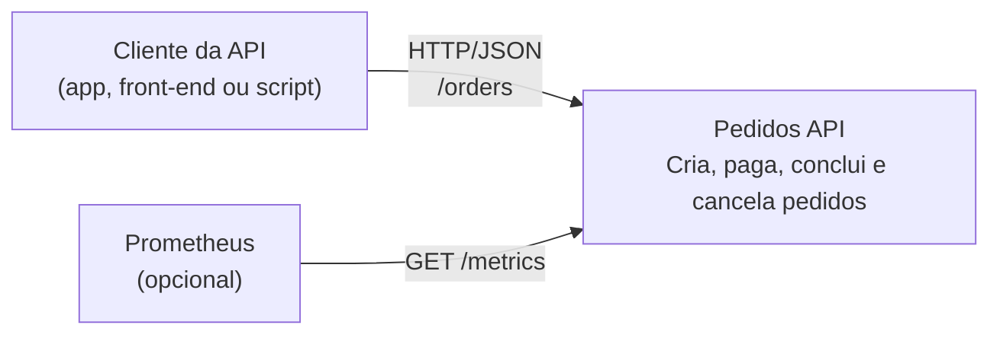

# C4 — Nível 1: Contexto

Visão do sistema e de quem/o que interage com ele.

## Elementos

| Elemento       | Tipo            | Descrição                                                                                  |
| -------------- | --------------- | ------------------------------------------------------------------------------------------ |
| Cliente da API | Pessoa/sistema  | Quem consome a API para gerenciar pedidos.                                                 |
| Pedidos API    | Sistema (este)  | API REST em Node/TypeScript. Mantém os pedidos em memória (ver ADR 0001).                  |
| Prometheus     | Sistema externo | Coletor de métricas, opcional. Lê `GET /metrics` para acompanhar latência e SLO.           |

## Fora do escopo

Pagamento real, autenticação e banco de dados externo não existem neste projeto: `pay` apenas muda o estado do
pedido. A fronteira está desenhada para que um gateway de pagamento ou um banco entrem depois como novos sistemas
externos, sem alterar o domínio.
